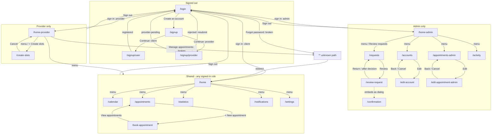
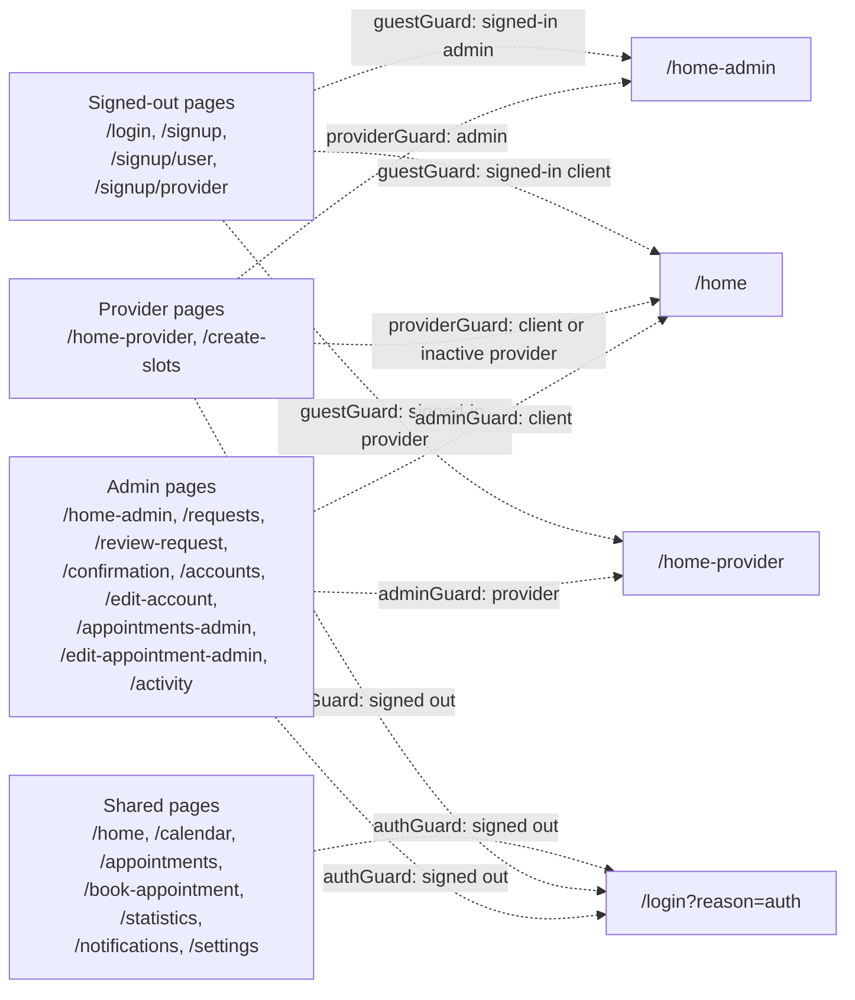

# BAAAM navigation flow

Navigation flow of the Angular frontend for Document 3 (BAAAM-44 / BAAAM-97), taken from the routes, guards, header menus, and in-page links as of Nov 5, 2026.

**Sources**

- [`src/frontend/src/app/app.routes.ts`](../src/frontend/src/app/app.routes.ts)
- [`src/frontend/src/app/core/guards/auth.guard.ts`](../src/frontend/src/app/core/guards/auth.guard.ts)
- Header menus in [`src/frontend/src/app/app.component.ts`](../src/frontend/src/app/app.component.ts) (`CLIENT_NAV`, `PROVIDER_NAV`, `ADMIN_NAV`)
- `routerLink`, `navigate`, and `navigateByUrl` calls under `src/frontend/src/app/pages`

## Guards

| Guard | Allows | Redirect when blocked |
| --- | --- | --- |
| `guestGuard` | Signed-out users | Signed-in admin to `/home-admin`, provider to `/home-provider`, client to `/home` |
| `authGuard` | Any signed-in user | Signed-out to `/login?reason=auth&returnUrl=<page>` |
| `providerGuard` | Signed-in service providers whose account is active (`isServiceProvider` and `isActive !== false`) | Signed-out to `/login?reason=auth&returnUrl=<page>`, admin to `/home-admin`, anyone else to `/home` |
| `adminGuard` | Signed-in admins (`isAdmin`) | Signed-out to `/login?reason=auth`, provider to `/home-provider`, anyone else to `/home` |

Every provider and admin route lists `authGuard` first, so a signed-out user is always stopped by `authGuard` (with a `returnUrl`) before `providerGuard` or `adminGuard` runs.

After sign-in, [`login.component.ts`](../src/frontend/src/app/pages/login/login.component.ts) sends the user to `returnUrl` if it is a safe, role-appropriate path, and otherwise to their role's home page (`/home-admin`, `/home-provider`, or `/home`).

## Header menus

The header (and its Sign out button) is shown on every page except login and the three signup pages.

| Role | Menu items |
| --- | --- |
| Client | Home (`/`), Calendar, Appointments, Notifications, Statistics, Settings |
| Provider | Home (`/home-provider`), Calendar, Create appointments (`/create-slots`), Notification, Settings, Stats |
| Admin | Home (`/home-admin`), Requests, Accounts, Appointments (`/appointments-admin`), Activity |

`/` redirects to `/home`. Sign out always goes to `/login`.

## Routes by role

"Shared" means the route checks only `authGuard`, so every signed-in role can open it.

| Path | Guards | Signed out | Client | Provider | Admin |
| --- | --- | --- | --- | --- | --- |
| `/login` | `guestGuard` | Yes | Role home | Role home | Role home |
| `/signup` | `guestGuard` | Yes | Role home | Role home | Role home |
| `/signup/user` | `guestGuard` | Yes | Role home | Role home | Role home |
| `/signup/provider` | `guestGuard` | Yes | Role home | Role home | Role home |
| `/home` | `authGuard` | `/login` | Yes | Shared | Shared |
| `/calendar` | `authGuard` | `/login` | Yes | Shared (menu) | Shared |
| `/appointments` | `authGuard` | `/login` | Yes | Shared | Shared |
| `/book-appointment` | `authGuard` | `/login` | Yes | Shared | Shared |
| `/statistics` | `authGuard` | `/login` | Yes | Shared (menu) | Shared |
| `/notifications` | `authGuard` | `/login` | Yes | Shared (menu) | Shared (URL only) |
| `/settings` | `authGuard` | `/login` | Yes | Shared (menu) | Shared (URL only) |
| `/home-provider` | `authGuard`, `providerGuard` | `/login` | `/home` | Yes | `/home-admin` |
| `/create-slots` | `authGuard`, `providerGuard` | `/login` | `/home` | Yes | `/home-admin` |
| `/home-admin` | `authGuard`, `adminGuard` | `/login` | `/home` | `/home-provider` | Yes |
| `/requests` | `authGuard`, `adminGuard` | `/login` | `/home` | `/home-provider` | Yes |
| `/review-request` | `authGuard`, `adminGuard` | `/login` | `/home` | `/home-provider` | Yes |
| `/confirmation` | `authGuard`, `adminGuard` | `/login` | `/home` | `/home-provider` | Yes (no link) |
| `/accounts` | `authGuard`, `adminGuard` | `/login` | `/home` | `/home-provider` | Yes |
| `/edit-account` | `authGuard`, `adminGuard` | `/login` | `/home` | `/home-provider` | Yes |
| `/appointments-admin` | `authGuard`, `adminGuard` | `/login` | `/home` | `/home-provider` | Yes |
| `/edit-appointment-admin` | `authGuard`, `adminGuard` | `/login` | `/home` | `/home-provider` | Yes |
| `/activity` | `authGuard`, `adminGuard` | `/login` | `/home` | `/home-provider` | Yes |
| `''` (empty) | redirect | `/home` | `/home` | `/home` | `/home` |
| `**` (anything else) | redirect | `/home` | `/home` | `/home` | `/home` |

## Diagram 1: page transitions

Arrows are links, buttons, menu items, and the navigation that happens after an action (sign in, sign up, sign out). To keep the chart readable, header-menu arrows start from each role's home page even though the menu is on every signed-in page, and Sign out is drawn once per role.

Smaller links left off the chart: the "Account type" and "Sign in" back links on the signup pages, the client home's "Book an appointment" button (it opens `/appointments`), and the `''` empty path, which redirects to `/home` like `**`. The provider menu arrow points at the whole shared group; the menu's shared items are Calendar, Notification, Settings, and Stats.

## Diagram 2: guard redirects

What happens when someone opens a page they aren't allowed on. Each box is a group of pages from the routes table; the arrow label names the guard and who it stops.

## Findings

1. **`home-provider` is declared twice** in `app.routes.ts` (lines 164 and 185). The router uses the first match, so the second entry is dead configuration.
2. **Client pages are shared with every role.** `/home`, `/calendar`, `/appointments`, `/book-appointment`, and `/statistics` check only `authGuard`, so providers and admins can open them by URL. The same is true of `/notifications` and `/settings`. The provider menu links to calendar, notifications, settings, and statistics on purpose.
3. **The admin menu has no Notifications or Settings item**, although admins can open both pages by URL.
4. **`/confirmation` has no link.** It is an admin route, but the confirmation prompt is actually used as a dialog inside `/review-request`.
5. **Two links point at routes that don't exist**, so the `**` catch-all sends them to `/home`:
   - "Forgot password" on login links to `/forgot-password`. A signed-out user is redirected to `/home`, then `authGuard` sends them back to `/login` with "Please sign in first."
   - "Manage appointments" on the provider home links to `/provider`. The provider lands on the client home page.
6. **"Book an appointment" on the client home opens `/appointments`, not `/book-appointment`.** Booking starts from "+ New appointment" on the appointments page.
7. **The `adminGuard` doc comment is out of date.** It lists six admin pages and leaves out `edit-account`, `edit-appointment-admin`, and `activity`, which BAAAM-148 added. The guard still protects them.
