# BAAAM navigation flow

Generated from the live Angular routes and guards for Document 3 (BAAAM-44 / BAAAM-97).

**Sources**

- [`src/frontend/src/app/app.routes.ts`](../src/frontend/src/app/app.routes.ts)
- [`src/frontend/src/app/core/guards/auth.guard.ts`](../src/frontend/src/app/core/guards/auth.guard.ts)
- Role menus in [`src/frontend/src/app/app.component.ts`](../src/frontend/src/app/app.component.ts) (`CLIENT_NAV`, `PROVIDER_NAV`, `ADMIN_NAV`)
- In-page `routerLink` / `navigate` / `navigateByUrl` calls under `src/frontend/src/app/pages`

## Guards

| Guard | Allows | Redirect when blocked |
| --- | --- | --- |
| `guestGuard` | Signed-out users only | Signed-in admin → `/home-admin`; provider → `/home-provider`; client → `/home` |
| `authGuard` | Any signed-in user | Signed-out → `/login?reason=auth&returnUrl=…` |
| `providerGuard` | Signed-in active service provider (`isServiceProvider` and `isActive !== false`) | Signed-out → `/login?reason=auth&returnUrl=…`; admin → `/home-admin`; otherwise → `/home` |
| `adminGuard` | Signed-in admin (`isAdmin`) | Signed-out → `/login?reason=auth`; provider → `/home-provider`; otherwise → `/home` |

Post-login destination ([`login.component.ts`](../src/frontend/src/app/pages/login/login.component.ts)): prefer a safe `returnUrl`, else role home (`/home-admin`, `/home-provider`, or `/home`).

## Role menus (shell nav)

| Role | Paths in header |
| --- | --- |
| Client | `/`, `/calendar`, `/appointments`, `/notifications`, `/statistics`, `/settings` |
| Provider | `/home-provider`, `/calendar`, `/create-slots`, `/notifications`, `/settings`, `/statistics` |
| Admin | `/home-admin`, `/requests`, `/accounts`, `/appointments-admin` |

`/` redirects to `/home`. Admin has no shell links for notifications or settings, but those routes only use `authGuard`, so admins can still open them by URL.

## Route × guard × role

| Path | Guards | Signed-out | Client | Provider | Admin |
| --- | --- | --- | --- | --- | --- |
| `/login` | `guestGuard` | yes | redirect home | redirect home | redirect home |
| `/signup` | `guestGuard` | yes | redirect home | redirect home | redirect home |
| `/signup/user` | `guestGuard` | yes | redirect home | redirect home | redirect home |
| `/signup/provider` | `guestGuard` | yes | redirect home | redirect home | redirect home |
| `/home` | `authGuard` | → login | yes | **shared** | **shared** |
| `/calendar` | `authGuard` | → login | yes | **shared** | **shared** |
| `/appointments` | `authGuard` | → login | yes | **shared** | **shared** |
| `/book-appointment` | `authGuard` | → login | yes | **shared** | **shared** |
| `/statistics` | `authGuard` | → login | yes | **shared** | **shared** |
| `/notifications` | `authGuard` | → login | yes | yes (nav) | **shared** (URL only) |
| `/settings` | `authGuard` | → login | yes | yes (nav) | **shared** (URL only) |
| `/home-provider` | `authGuard`, `providerGuard` | → login | → `/home` | yes | → `/home-admin` |
| `/create-slots` | `authGuard`, `providerGuard` | → login | → `/home` | yes | → `/home-admin` |
| `/home-admin` | `authGuard`, `adminGuard` | → login | → `/home` | → `/home-provider` | yes |
| `/requests` | `authGuard`, `adminGuard` | → login | → `/home` | → `/home-provider` | yes |
| `/review-request` | `authGuard`, `adminGuard` | → login | → `/home` | → `/home-provider` | yes |
| `/confirmation` | `authGuard`, `adminGuard` | → login | → `/home` | → `/home-provider` | yes (no nav link; dialog) |
| `/accounts` | `authGuard`, `adminGuard` | → login | → `/home` | → `/home-provider` | yes |
| `/appointments-admin` | `authGuard`, `adminGuard` | → login | → `/home` | → `/home-provider` | yes |
| `''` | redirect | → `/home` | → `/home` | → `/home` | → `/home` |
| `**` | redirect | → `/home` | → `/home` | → `/home` | → `/home` |

Shared pages: any signed-in role can open them because the route only checks `authGuard`. Client-oriented pages (home, calendar, appointments, book-appointment, statistics) plus notifications and settings are documented that way below.

## Flowchart

Solid edges: in-app links and menus. Dotted edges: guard redirects. Labels name the guard or the post-action reason.

```mermaid
flowchart TD
  subgraph signedOut [Signed-out - guestGuard]
    login["/login"]
    signup["/signup"]
    signupUser["/signup/user"]
    signupProvider["/signup/provider"]
  end

  subgraph shared [Shared - authGuard only]
    home["/home"]
    calendar["/calendar"]
    appointments["/appointments"]
    bookAppointment["/book-appointment"]
    statistics["/statistics"]
    notifications["/notifications"]
    settings["/settings"]
  end

  subgraph providerOnly [Provider - authGuard + providerGuard]
    homeProvider["/home-provider"]
    createSlots["/create-slots"]
  end

  subgraph adminOnly [Admin - authGuard + adminGuard]
    homeAdmin["/home-admin"]
    requests["/requests"]
    reviewRequest["/review-request"]
    confirmation["/confirmation"]
    accounts["/accounts"]
    appointmentsAdmin["/appointments-admin"]
  end

  subgraph redirects [Catch-all redirects]
    emptyPath["''"]
    wildcard["**"]
  end

  %% Guest flows
  signup --> signupUser
  signup --> signupProvider
  signupUser -->|"registered"| login
  signupProvider -->|"provider-pending"| login
  login -->|"Create an account"| signup
  login -->|"resubmit rejected provider"| signupProvider
  login -->|"sign-in: client"| home
  login -->|"sign-in: provider"| homeProvider
  login -->|"sign-in: admin"| homeAdmin

  %% Guest guard: signed-in users bounced off guest pages
  signup -.->|"guestGuard"| home
  signupUser -.->|"guestGuard"| home
  signupProvider -.->|"guestGuard"| home
  login -.->|"guestGuard → role home"| home
  login -.->|"guestGuard → role home"| homeProvider
  login -.->|"guestGuard → role home"| homeAdmin

  %% Auth guard into shared
  home -.->|"authGuard → /login"| login
  calendar -.->|"authGuard → /login"| login
  appointments -.->|"authGuard → /login"| login
  bookAppointment -.->|"authGuard → /login"| login
  statistics -.->|"authGuard → /login"| login
  notifications -.->|"authGuard → /login"| login
  settings -.->|"authGuard → /login"| login

  %% Client / shared transitions
  home -->|"Book an appointment"| appointments
  appointments -->|"+ New appointment"| bookAppointment
  bookAppointment -->|"Back / View / Cancel"| appointments

  %% Provider transitions and guards
  homeProvider -->|"+ Create slots"| createSlots
  createSlots -->|"Cancel"| homeProvider
  homeProvider -.->|"providerGuard: admin"| homeAdmin
  homeProvider -.->|"providerGuard: non-provider"| home
  createSlots -.->|"providerGuard: admin"| homeAdmin
  createSlots -.->|"providerGuard: non-provider"| home
  homeProvider -.->|"authGuard → /login"| login
  createSlots -.->|"authGuard → /login"| login

  %% Admin transitions and guards
  homeAdmin -->|"Review / View requests"| requests
  requests -->|"row → review"| reviewRequest
  reviewRequest -->|"Return / after decide"| requests
  reviewRequest -.->|"embeds ConfirmationPrompt"| confirmation
  homeAdmin -.->|"adminGuard: provider"| homeProvider
  homeAdmin -.->|"adminGuard: client"| home
  requests -.->|"adminGuard: provider"| homeProvider
  accounts -.->|"adminGuard: provider"| homeProvider
  appointmentsAdmin -.->|"adminGuard: provider"| homeProvider
  reviewRequest -.->|"adminGuard: client"| home
  confirmation -.->|"adminGuard: client"| home
  homeAdmin -.->|"authGuard → /login"| login
  requests -.->|"authGuard → /login"| login
  reviewRequest -.->|"authGuard → /login"| login
  confirmation -.->|"authGuard → /login"| login
  accounts -.->|"authGuard → /login"| login
  appointmentsAdmin -.->|"authGuard → /login"| login

  %% Shell: sign out
  home -->|"Sign out"| login
  homeProvider -->|"Sign out"| login
  homeAdmin -->|"Sign out"| login

  %% Catch-alls land on /home (then authGuard may send signed-out users to login)
  emptyPath -->|"redirectTo"| home
  wildcard -->|"redirectTo"| home
```

## Findings

1. **`home-provider` is declared twice** in `app.routes.ts` (first around the create-slots block, then again after `create-slots`). The second entry is unreachable duplicate configuration.
2. **Client pages are shared.** `/home`, `/calendar`, `/appointments`, `/book-appointment`, and `/statistics` (plus `/notifications` and `/settings`) use only `authGuard`, so providers and admins can reach them by URL. Provider nav intentionally includes calendar, notifications, settings, and statistics.
3. **Admin shell omits notifications and settings**, even though those routes are reachable by any signed-in user.
4. **`/confirmation` is an admin-guarded route with no navigation link.** The UI embeds `ConfirmationPromptComponent` inside review-request; the standalone `/confirmation` route is unused by the menus.
5. **Broken links fall through `**` → `/home`:**
   - Login links to `/forgot-password` (no route). A signed-out visitor is redirected to `/home`, then `authGuard` sends them back to `/login`.
   - Provider home links to `/provider` (“Manage appointments”). That path does not exist; the catch-all sends the provider to `/home` (the client shared page).
6. **Home CTA routing:** the client home “Book an appointment” button goes to `/appointments`, not `/book-appointment`. Booking itself is opened from appointments via “+ New appointment”.
